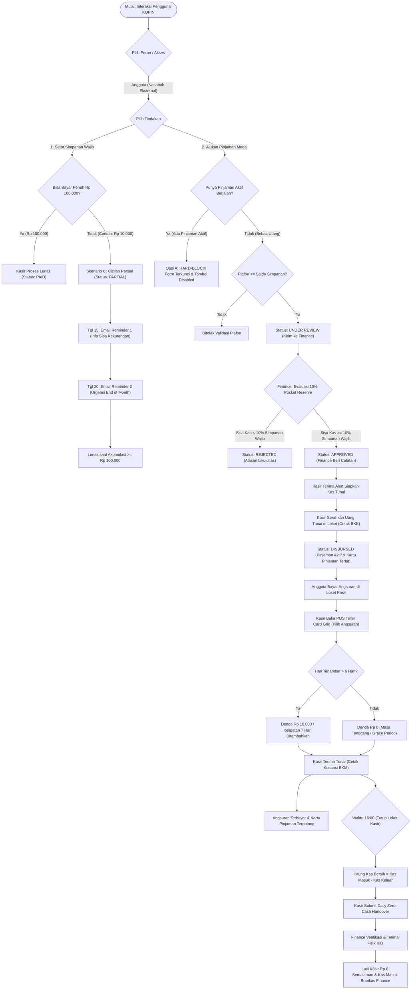

# KOPIN — KSP Core Enterprise System
> **Sistem Informasi Koperasi Simpan Pinjam Terintegrasi Multi-Role**  
> Didesain dengan standar tata kelola keuangan profesional, pemisahan wewenang (*Segregation of Duties*), perlindungan likuiditas (*Prudential Cash Reserve 10%*), dan integritas pembukuan ganda (*Dual Ledger*).

---

## 📌 Ringkasan Sistem

**KOPIN** adalah platform web perusahaan untuk Koperasi Simpan Pinjam (KSP) yang melayani anggota masyarakat umum dan karyawan internal. Sistem ini menghubungkan nasabah dengan staf operasional kantor, manajemen risiko keuangan, dan pengawas sistem secara *real-time*.

### Nilai Utama & Keunggulan Arsitektur:
1. **Multi-Role & Multi-Guard Session Isolation:**  
   Pemisahan portal dan sesi login independen untuk 5 aktor tanpa bentrok sesi dalam satu browser: **Anggota**, **Karyawan**, **Kasir**, **Finance**, dan **Admin**.
2. **Prudential Liquidity Control (10% Pocket Reserve):**  
   Finance secara otomatis menjaga batas minimal cadangan kas sebesar **10% dari total simpanan wajib seluruh anggota** sebelum menyetujui pencairan pinjaman modal baru.
3. **Pemisahan Wewenang (Segregation of Duties):**  
   Admin fokus pada master data & audit log (tidak memegang uang), Kasir melayani fisik uang di loket kantor, dan Finance memegang brankas serta persetujuan likuiditas.
4. **Cicilan Parsial Simpanan Wajib (Skenario C):**  
   Mendukung anggota yang belum mampu membayar simpanan wajib Rp 100.000 sekaligus (misal hanya mampu Rp 10.000). Setoran langsung menambah saldo tabungan, tercatat berstatus `partial`, dan dilengkapi email pengingat dinamis pada tanggal 15 & 20 yang menyebutkan sisa kekurangan secara presisi.
5. **Kebijakan Pinjaman Tunggal (Opsi A - Strict Hard-Block):**  
   Mencegah *overleveraging* nasabah dengan mengunci keras pengajuan pinjaman baru jika anggota masih memiliki pinjaman modal yang sedang berjalan.
6. **POS Teller Card Grid di Loket Kasir:**  
   Antarmuka loket kasir modern ala kasir bank/POS dengan kartu visual yang hanya memunculkan tagihan angsuran terdekat (*next due installment*), kalkulasi denda otomatis, dan pencetakan kuitansi BKM instan.
7. **Daily Zero-Cash Closing Jam 16:00:**  
   Kasir wajib menyetorkan 100% uang fisik di laci ke Finance setiap sore hari, diverifikasi oleh Finance, sehingga kasir tidak menyimpan kas semalaman (*zero overnight physical cash risk*).
8. **Dual Ledger (Buku Tabungan vs Kartu Pinjaman):**  
   Mencegah kebingungan saldo minus dengan memisahkan pencatatan saldo tabungan anggota dari kewajiban utang pinjaman modal.

---

## 🌳 Decision Tree Sistem (Mermaid Flowchart)

Berikut adalah diagram pohon keputusan (*decision tree*) alur bisnis operasional terintegrasi di KOPIN:



---

## 👥 Arsitektur 5 Role & Hak Akses

| Role / Aktor | Portal Login | Karakteristik Utama |
| :--- | :--- | :--- |
| **1. Anggota** | `/login` | Anggota eksternal. Menabung Simpanan Wajib tunai (bisa cicil sebagian), mengajukan penarikan tunai di loket, pengajuan pinjaman modal (*strict hard-block* jika ada pinjaman aktif), live tracking status, melihat Buku Tabungan & Kartu Pinjaman. |
| **2. Karyawan** | `/karyawan/login` | Anggota internal perusahaan. Menabung **Simpanan Sukarela otomatis potong gaji** (*payroll deduction*), cicilan pinjaman otomatis potong gaji, pencairan saldo sukarela saat *resign*. |
| **3. Kasir** | `/kasir/login` | Petugas loket kantor. Menerima setoran tunai & cetak kuitansi BKM, melayani penarikan tunai tabungan (BKK), menyerahkan uang pencairan pinjaman tunai anggota yang disetujui Finance, menerima angsuran via POS Teller Grid, serta *closing* kas sore jam 16.00. |
| **4. Finance** | `/finance/login` | Pengelola brankas & likuiditas. Evaluasi batas *10% Pocket Reserve*, persetujuan/penolakan pinjaman modal dengan catatan transparan, serta verifikasi fisik kas *closing* harian kasir jam 16:00. |
| **5. Admin** | `/admin/login` | Administrator sistem. Verifikasi KYC pendaftaran anggota baru, manajemen data master, konfigurasi sistem, dan pemantauan jejak audit (*Audit Log*). Tidak memegang uang fisik. |

---

## 🔄 Rincian Fitur Utama

### 1. Siklus Menabung Simpanan Wajib (Skenario C: Cicilan Parsial)
* **Periode:** Berlaku dari tanggal 1 hingga akhir bulan (*End of Month* / EOM).
* **Nominal Standar:** Rp 100.000 / bulan.
* **Cicilan Parsial:** Anggota yang belum mampu membayar penuh dapat menyetor nominal bertahap di kasir (misal: Rp 10.000). Uang langsung tercatat masuk ke tabungan, status menjadi `partial`, dan sisa kewajiban Rp 90.000 tercantum di struk BKM.
* **Email Reminder Terjadwal:**
  * **Tanggal 15:** Mengirimkan email ramah gotong royong yang secara dinamis menginformasikan nominal terbayar dan sisa kewajiban.
  * **Tanggal 20:** Mengirimkan email urgensi penyelesaian sebelum akhir bulan bagi yang belum lunas penuh.

### 2. Validasi Pinjaman Modal (Opsi A - Strict Hard-Block)
* **Single Active Loan:** Nasabah yang sedang memiliki pinjaman berjalan dilarang keras mengajukan pinjaman baru.
* **Proteksi UI & Backend:** Tampilan `/loans/create` otomatis menampilkan banner merah berisikan nomor pinjaman aktif dan sisa saldo kewajiban, tombol submit terkunci (*disabled*), dan validasi sisi controller menolak tegas manipulasi request.

### 3. POS Teller Card Grid untuk Kasir
* Menggantikan dropdown panjang yang membingungkan dengan antarmuka kasir modern (POS).
* Menampilkan kartu tagihan pinjaman anggota per nasabah yang hanya memunculkan angsuran jatuh tempo berikutnya (*next due installment*).
* Menghitung keterlambatan hari dan denda otomatis (gratis hari 1–6, denda Rp 10.000 per kelipatan 7 hari pada hari ke-7+).
* Kasir klik kartu $\rightarrow$ nominal & denda otomatis terisi $\rightarrow$ klik Terima Tunai $\rightarrow$ cetak kuitansi BKM resmi.

### 4. Evaluasi Cadangan Kas 10% (Finance Pocket Reserve)
* Sebelum Finance menyetujui pengajuan pinjaman modal, sistem menghitung:
  $$\text{Ambang Batas Minimum Kas} = 10\% \times \text{Total Simpanan Wajib Seluruh Anggota}$$
  $$\text{Kas Tersedia Pasca Pencairan} = \text{Kas Koperasi} - \text{Nominal Pinjaman}$$
* Jika kas pasca pencairan $< 10\%$, sistem mewajibkan penolakan (*REJECTED*) demi menjaga solvabilitas koperasi.

### 5. Tutup Kas Harian Jam 16:00 (Daily Zero-Cash Handover)
* Mengamankan uang loket kantor setiap sore.
* Sistem menghitung kas fisik bersih:
  $$\text{Saldo Kas Fisik Siap Diserahkan} = \max(0,\ \text{Total Kas Masuk} - \text{Total Kas Keluar})$$
* Kasir menekan tombol serah terima kas di dashboard loket $\rightarrow$ data masuk ke Finance berstatus `pending`.
* Staf Finance menerima uang fisik, mencocokkan hitungan, dan menekan tombol **"Verifikasi & Terima Uang Fisik"** di dashboard Finance.
* Status berubah menjadi `verified`, kasir menerima notifikasi resmi, dan laci loket kembali Rp 0 semalaman.

---

## 🛠️ Teknologi & Stack

* **Framework:** Laravel 12.x
* **Bahasa:** PHP 8.2+
* **Database:** MySQL / MariaDB (Didukung SQLite)
* **Frontend:** Blade Templating, Vanilla CSS, FontAwesome 6, Google Fonts (*Plus Jakarta Sans* & *JetBrains Mono*)
* **Architecture:** Multi-Guard Session Authentication, Authoritative Server-side Calculations, Atomic Database Transactions, Notification Registry Enums.

---

## 🚀 Panduan Instalasi & Menjalankan Proyek

### 1. Kloning & Dependensi
```bash
# Masuk ke direktori proyek
cd KSP_CORE_ENTERPRISE_SYSTEM

# Install dependensi PHP
composer install

# Salin konfigurasi environment
cp .env.example .env

# Generate Application Key
php artisan key:generate
```

### 2. Migrasi Database & Seeder
```bash
# Jalankan migrasi dan isi data demo
php artisan migrate --seed
```

### 3. Menjalankan Server Lokal
```bash
php artisan serve
```
Akses aplikasi melalui browser di `http://127.0.0.1:8000` (atau port yang tertera).

---

## 🔑 Akun Demo Pengujian

| Role | Email | Password | Keterangan |
| :--- | :--- | :--- | :--- |
| **Admin** | `admin@kopin.id` | `password123` | Master data, KYC verifikasi anggota, audit log |
| **Finance** | `finance@kopin.id` | `password123` | Persetujuan likuiditas 10% reserve & verifikasi closing kasir |
| **Kasir** | `kasir@kopin.id` | `password123` | Pelayanan loket kasir, POS angsuran, pencairan, & closing sore |
| **Anggota (Fauzi)** | `fauzi@kopin.id` | `password123` | Anggota aktif dengan pengujian pinjaman & simpanan |
| **Anggota (Budi)** | `budi@kopin.id` | `password123` | Anggota aktif dengan pinjaman angsuran berjalan |
| **Karyawan** | `karyawan@kopin.id` | `password123` | Karyawan internal dengan simpanan sukarela payroll deduction |
| **Anggota (Baru)** | `siti@kopin.id` | `password123` | Anggota baru pending verifikasi KYC oleh Admin |

---

## 📖 Dokumentasi Lengkap
* **Buku Panduan & Helper Pengujian Interaktif:** Buka berkas [helper.html](file:///c:/laragon/www/KSP_CORE_ENTERPRISE_SYSTEM/helper.html) di browser Anda untuk panduan skenario testing langkah demi langkah.
* **Product Requirement Document:** [PRD.MD](file:///c:/laragon/www/KSP_CORE_ENTERPRISE_SYSTEM/PRD/PRD.MD).

---

## 📄 Lisensi
Hak Cipta © 2026 KOPIN Enterprise System. Dilindungi oleh hukum dan regulasi perkoperasian yang berlaku.
